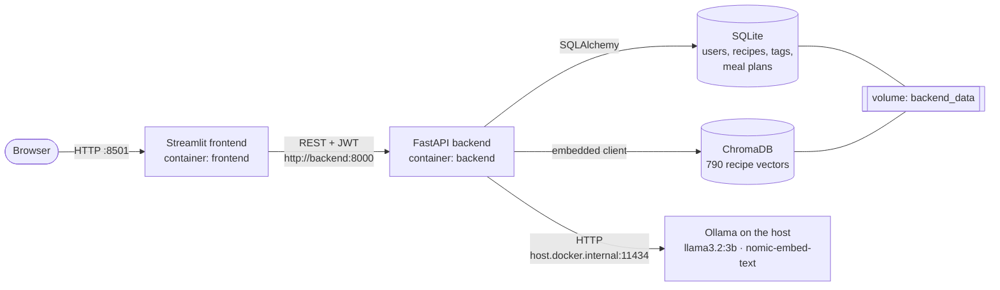

# 🍴 ForkCast — AI Recipe Assistant

ForkCast finds recipes by *meaning*, respects your dietary needs, and plans your week from a real collection of 790 recipes. Ask "I have chickpeas and spinach, what can I make tonight?" and it answers with recipes it can cite. It never invents dishes, and it says so when nothing fits. It can also turn a meal plan into a shopping list that leaves out what you already have.

Built with FastAPI, SQLAlchemy, ChromaDB, Ollama and Streamlit, and it all runs with `docker compose up`.

---

## Architecture



| Service | Where it runs | Talks to |
|---|---|---|
| `frontend` (Streamlit) | Docker | `backend` by service name only |
| `backend` (FastAPI + RAG) | Docker | SQLite + ChromaDB in-process; Ollama over HTTP |
| Ollama | Your machine, natively (uses the GPU on Apple Silicon) | reached from Docker at `host.docker.internal:11434` |

**How a question is answered (`POST /ask`)**

1. The question is embedded with `nomic-embed-text`.
2. ChromaDB returns the 5 closest recipes, filtered by diet tags (`vegan`, `gluten-free`, …).
3. **Guardrail:** if even the best match is too far away (cosine distance > 0.41), ForkCast replies *"I couldn't find a recipe in the collection that fits"* without calling the LLM.
4. Otherwise `llama3.2:3b` gets the retrieved recipes and strict instructions: use only these recipes, cite them as `[#id]`, and only state diet labels that appear in the tags.
5. The backend keeps only citations that match recipes it actually retrieved, and returns `{answer, sources, grounded}`.

**Database schema**

```
users 1──N recipes N──N tags              (via recipe_tags)
users 1──N meal_plans 1──N meal_plan_items N──1 recipes
```

More detail is in [docs/design.md](docs/design.md).

---

## Prerequisites

- **Docker Desktop** (or Docker Engine with Compose v2)
- **Ollama** running on your machine: <https://ollama.com/download>
- The two models:
  ```bash
  ollama pull llama3.2:3b
  ollama pull nomic-embed-text
  ```
- **Python 3.12**, only for running tests or developing outside Docker

## Setup

```bash
# 1. Clone
git clone https://github.com/barratmohammad/forkcast.git && cd forkcast

# 2. Configure
cp .env.example .env
python3 -c "import secrets; print(secrets.token_urlsafe(48))"   # paste the output as JWT_SECRET in .env

# 3. Make sure Ollama is running (the desktop app, or `ollama serve`)

# 4. Start everything
docker compose up --build
```

Then open **<http://localhost:8501>**. The API docs (Swagger) are at **<http://localhost:8000/docs>**.

On first start the backend loads the 790 bundled recipes and embeds them in the background, which takes about 15 seconds to a few minutes depending on your machine. The sidebar's **Indexed** counter shows progress. Your data lives in the `backend_data` Docker volume, so it survives `docker compose down`. Use `docker compose down -v` to start fresh.

> **Port already in use?** Set `BACKEND_PORT` / `FRONTEND_PORT` in `.env` (e.g. `8010` / `8511`) and open the frontend on that port instead.

## Usage Guide

1. **Create an account** on the login screen. Passwords need at least 8 characters.
2. **Set diet filters** in the sidebar (vegetarian, vegan, gluten-free, dairy-free). They apply to chat, search and meal plans.
3. **💬 Ask the Chef:** ask anything about what to cook. Each answer lists its **sources**; expand one to see the full recipe and its match score. Off-topic questions get an honest "no match" instead of a made-up answer.
4. **🔎 Browse:** search by **keyword** (titles and ingredients) or by **meaning**, where "cozy winter soup" finds stews even if those words aren't in the recipe.
5. **📖 My Recipes:** create, edit and delete your own recipes. Diet tags are detected automatically from the ingredients, or you can set them yourself. New recipes are searchable straight away.
6. **🗓️ Meal Plan:** choose days, meals per day and the ingredients you already have. ForkCast picks recipes from the collection, builds a **shopping list** without the things you already have, and lets you **download** it as a Markdown checklist.

## API Endpoints

🔒 = needs `Authorization: Bearer <token>` (get one from `POST /auth/token`).

| Method | Path | Description | Auth |
|---|---|---|---|
| POST | `/auth/register` | Create an account | — |
| POST | `/auth/token` | Log in (OAuth2 form) → JWT | — |
| GET | `/auth/me` | Current user | 🔒 |
| GET | `/recipes` | Browse with `q`, `tag`, `cuisine`, `mine`, `limit`, `offset` | 🔒 |
| POST | `/recipes` | Create a recipe (auto-tags diets, indexes for search) | 🔒 |
| GET | `/recipes/{id}` | Get one recipe | 🔒 |
| PUT | `/recipes/{id}` | Update your recipe (re-tags and re-indexes) | 🔒 |
| DELETE | `/recipes/{id}` | Delete your recipe | 🔒 |
| GET | `/tags` | Diet tags with recipe counts | 🔒 |
| POST | `/search` | Semantic search (vector similarity, no LLM) | 🔒 |
| POST | `/ask` | RAG question answering with cited sources | 🔒 |
| POST | `/meal-plans` | Generate a meal plan from the collection | 🔒 |
| GET | `/meal-plans` | List your plans | 🔒 |
| GET | `/meal-plans/{id}` | Get a plan | 🔒 |
| DELETE | `/meal-plans/{id}` | Delete a plan | 🔒 |
| GET | `/meal-plans/{id}/shopping-list` | Aggregated shopping list | 🔒 |
| POST | `/admin/reindex` | Rebuild the vector index from the database | 🔒 |
| GET | `/health` | Database, vector store and Ollama status | — |

Every request and response body is a Pydantic model. Invalid input returns `422` with field-level messages.

## Tech Stack

| Layer | Technology |
|---|---|
| API | FastAPI, Pydantic v2, Uvicorn |
| Database | SQLAlchemy 2.0, SQLite |
| Auth | JWT (PyJWT, HS256), bcrypt password hashing |
| Vector store | ChromaDB (embedded, cosine distance) |
| LLM + embeddings | Ollama: `llama3.2:3b` (chat), `nomic-embed-text` (embeddings) |
| Frontend | Streamlit |
| Packaging | Docker, Docker Compose |
| Quality | pytest, ruff |
| Data | [TheMealDB](https://www.themealdb.com) (free API for educational use) |

## Testing

```bash
cd backend
python3.12 -m venv .venv && .venv/bin/pip install -r requirements-dev.txt
.venv/bin/pytest            # 72 tests
.venv/bin/ruff check .

cd ../frontend
python3.12 -m venv .venv && .venv/bin/pip install -r requirements-dev.txt
.venv/bin/pytest            # 9 tests
```

The tests never need Ollama. A fake client stands in for it, with deterministic embeddings and scripted replies, and each test gets an in-memory database and its own ChromaDB collection. They cover:

- **Auth:** register → login → protected route; wrong password; missing or garbage token; duplicate username
- **CRUD:** create/read/update/delete; editing someone else's recipe → 403; invalid bodies → 422; re-tagging and re-indexing when ingredients change
- **RAG:** `/ask` returns cited sources; off-topic questions trip the guardrail *without calling the LLM*; hallucinated citations are dropped; Ollama down → friendly 503
- **Meal plans:** the plan only ever contains real candidate recipes; invalid LLM JSON falls back gracefully; shopping list aggregation
- **Health:** always 200, reports "degraded" when Ollama is down

## Project Structure

```
├── docker-compose.yml        .env.example
├── backend/
│   ├── main.py               app factory, startup seeding, /health
│   ├── config.py             settings from environment variables
│   ├── database.py  models.py  schemas.py  auth.py
│   ├── ollama_client.py      HTTP client for Ollama (embed, chat)
│   ├── rag_pipeline.py       vector index, /ask logic, meal planning
│   ├── dietary.py            ingredient-based diet tagging
│   ├── shopping.py           shopping list aggregation
│   ├── seed.py               loads bundled recipes, syncs the index
│   ├── routers/              auth, recipes, ask, meal_plans
│   ├── data/seed_recipes.json
│   └── tests/
├── frontend/
│   ├── app.py                login gate, sidebar, tabs
│   ├── api_client.py         every API call; errors become friendly messages
│   ├── ui.py                 shared rendering helpers
│   └── views/                ask, browse, my_recipes, meal_plan
├── scripts/
│   ├── fetch_mealdb.py       one-time download of the recipe corpus
│   └── tune_threshold.py     measures distances to pick the guardrail threshold
└── docs/                     proposal, design
```

## Design Decisions

- **One chunk per recipe.** Recipes are short (150–400 tokens). Splitting one would separate the ingredients from the steps, and the whole recipe is the unit a user wants back.
- **Guardrail threshold of 0.41, measured rather than guessed.** `scripts/tune_threshold.py` ran 12 cooking questions and 8 off-topic ones against the real index. Cooking questions scored 0.19–0.39, and off-topic ones ("explain quantum computing", "how do I change a car tire") scored 0.42–0.53. The prompt's "say so if none fit" rule is a second line of defence for borderline cases.
- **Citation validation.** The model is told to cite `[#id]`. `llama3.2:3b` often writes `(#id)` instead, so the parser accepts any bracket style. Every cited id is checked against the recipes that were actually retrieved, and anything else is discarded.
- **The LLM picks meal plans but can't invent them.** It only sees about 20 retrieved candidates and must return their ids as JSON. Unknown ids are dropped and empty slots are filled with top-ranked candidates. That keeps plans grounded and makes the shopping list computable in plain Python.
- **Diet tags are rules, not AI.** Whole-word ingredient matching with exceptions (coconut milk is dairy-free, kidney beans aren't kidney). It's instant, testable and explainable. It found 14 recipes that TheMealDB itself labels "Vegetarian" but which contain chicken stock, lard, bacon or fish sauce.
- **Ollama runs on the host, not in Docker.** Docker on macOS can't use the Apple GPU, so a containerised Ollama is CPU-only and much slower.
- **ChromaDB is embedded and the database is SQLite.** There's one client of each and it's a single-user demo, so fewer containers means fewer things to break. SQLAlchemy keeps PostgreSQL one connection string away.
- **Failure tolerance.** If Ollama is down, the backend still starts, browsing and CRUD keep working, a background job retries indexing every 30 seconds (so recipes saved meanwhile, or a first start before Ollama, catch up automatically), and AI features return a clear 503 that the UI shows as a friendly message.

## Known Limitations & Future Improvements

- Diet tags are heuristic. They're shown with an allergy disclaimer and can be edited, but they're not a substitute for reading labels.
- The source data has gaps (e.g. one TheMealDB pork recipe lists no pork), which the tagger can't catch.
- Answers aren't streamed token by token. A spinner covers the 2–6 second wait.
- SQLite is single-writer. A multi-user deployment would move to PostgreSQL.
- Possible next steps: streaming responses, nutrition estimates, recipe images, sharing plans between users, hybrid keyword + vector search (BM25) for exact ingredient names, and a reranker for better ordering.

## Credits

Recipe data from [TheMealDB](https://www.themealdb.com), used under its free educational/test API terms.
