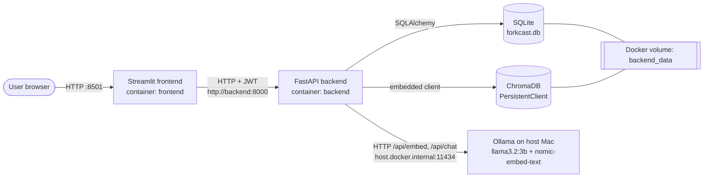

# ForkCast — System Design

Day 2 deliverable (architecture, schema, endpoints, Compose plan), plus the build spec for Days 3–12.
The one-page proposal is in [proposal.md](proposal.md).

## 1. Intent

A portfolio capstone that proves end-to-end skill with FastAPI, SQLAlchemy, JWT, RAG, Streamlit and Docker, built around something a non-engineer understands in five seconds: *"Tell it what you've got and what you can't eat; it finds real recipes and plans your week."*

**Goals**
- Every rubric item present and working, with `docker compose up` as the single start command (Ollama on the host is a documented prerequisite).
- RAG that is visibly grounded: every answer cites recipe IDs that exist in the database, and the app says "I don't know" rather than inventing a recipe.
- A smooth live demo under 2 minutes: log in → ask → cited answer → create/edit a recipe → generate a meal plan + shopping list.

**Non-goals**
- Image upload, nutrition/calorie math, multi-language support, social features, deployment to the cloud.
- Streaming token-by-token chat. Nice to have, but a spinner is enough.

**Anti-goals** (failure even if it "works")
- The LLM inventing recipes or ingredients that aren't in the collection.
- Mislabeling a recipe as safe for a diet when it isn't. Dietary tags are visible, editable, and flagged as heuristic.
- Stack traces in the UI. Every failure surfaces as a readable message.

## 2. Architecture



Plain-text version (for slides):

```
Browser ──8501──▶ [frontend: Streamlit] ──HTTP+JWT──▶ [backend: FastAPI] ──▶ SQLite      ┐
                                                         │                 ──▶ ChromaDB    ├─ volume: backend_data
                                                         └──HTTP──▶ Ollama (host Mac, GPU)
```

**Services**
| Service | Runs where | Talks to |
|---|---|---|
| `frontend` (Streamlit) | Docker | `backend` by service name (`http://backend:8000`) |
| `backend` (FastAPI + RAG) | Docker | SQLite + ChromaDB in-process; Ollama over HTTP |
| Ollama | Host Mac (native, uses Apple GPU) | reached at `host.docker.internal:11434` |

**Ask flow (core loop)**
1. User types "something spicy and vegetarian with chickpeas" and ticks "vegetarian" in Streamlit.
2. Streamlit `POST /ask` with Bearer token → FastAPI validates `AskRequest`.
3. Backend embeds the question via Ollama (`nomic-embed-text`, `search_query:` prefix).
4. ChromaDB query: top-5, `where={"vegetarian": True}`.
5. **Guardrail:** if the best match's cosine distance is above `RAG_MAX_DISTANCE`, return the "no good match" answer immediately (no LLM call).
6. Otherwise build a prompt with the retrieved recipes (ID, title, tags, ingredients, short instructions) and a system prompt: *answer only from these recipes, cite as [#id], say so if none fit*.
7. Ollama `/api/chat` → answer. Backend keeps only citations whose IDs were actually retrieved and returns `AskResponse{answer, sources[{recipe_id, title, score}], grounded}`.
8. Streamlit renders the answer plus source cards that link to the recipe detail.

**Storage**
- SQLite file and Chroma directory both live under `/app/storage` in the `backend_data` named volume, so they survive `docker compose down`.
- `.env` holds `JWT_SECRET` etc. and is git-ignored. `.env.example` is committed.

## 3. Database Schema (SQLAlchemy 2.0)

```
users 1──N recipes N──N tags            (via recipe_tags)
users 1──N meal_plans 1──N meal_plan_items N──1 recipes
```

| Table | Columns |
|---|---|
| `users` | `id` int PK · `username` str(50) unique, indexed · `hashed_password` str · `created_at` datetime |
| `recipes` | `id` int PK · `title` str(200) · `category` str(50) nullable (e.g. "Dessert") · `cuisine` str(50) nullable (e.g. "Italian") · `ingredients` JSON (list of `{name, measure}`) · `instructions` text · `source` str(20) (`"seed"`/`"user"`) · `owner_id` FK→users.id · `created_at`, `updated_at` |
| `tags` | `id` int PK · `name` str(30) unique (`vegetarian`, `vegan`, `gluten-free`, `dairy-free`) |
| `recipe_tags` | `recipe_id` FK · `tag_id` FK · composite PK |
| `meal_plans` | `id` int PK · `user_id` FK→users.id · `title` str · `request` JSON (days, diet, on-hand ingredients) · `notes` text (LLM rationale) · `created_at` |
| `meal_plan_items` | `id` int PK · `meal_plan_id` FK (cascade delete) · `recipe_id` FK · `day` int (1–7) · `meal` str (`lunch`/`dinner`) |

Relationships: `User.recipes`, `User.meal_plans`, `Recipe.owner`, `Recipe.tags` (secondary=`recipe_tags`), `MealPlan.items`, `MealPlanItem.recipe`.

Seed recipes belong to a built-in `forkcast` system user, whose password hash can never match a login, so `owner_id` stays non-null. Every user can read every recipe; only the owner can update or delete one.

## 4. API Endpoints

All request and response bodies are Pydantic v2 models. 🔒 = requires `Authorization: Bearer <JWT>`.

| Method | Path | Request → Response | Auth | Notes |
|---|---|---|---|---|
| POST | `/auth/register` | `UserCreate{username, password}` → `UserOut` | — | 409 if the username is taken; password ≥ 8 chars |
| POST | `/auth/token` | OAuth2 form → `Token{access_token, token_type}` | — | 401 "Incorrect username or password" |
| GET | `/auth/me` | → `UserOut` | 🔒 | |
| GET | `/recipes` | query: `q`, `tag` (repeatable), `cuisine`, `mine`, `limit`, `offset` → `RecipePage{items, total}` | 🔒 | Keyword/filter browse (SQL) |
| POST | `/recipes` | `RecipeCreate` → `RecipeOut` (201) | 🔒 | Auto-tags diets if none given; embeds into Chroma |
| GET | `/recipes/{id}` | → `RecipeOut` | 🔒 | 404 if missing |
| PUT | `/recipes/{id}` | `RecipeUpdate` → `RecipeOut` | 🔒 | Owner only (403); re-embeds |
| DELETE | `/recipes/{id}` | → 204 | 🔒 | Owner only; removes the Chroma vector |
| GET | `/tags` | → `list[TagOut]` | 🔒 | |
| POST | `/search` | `SearchRequest{query, tags[], k}` → `list[SearchHit{recipe, score}]` | 🔒 | Semantic retrieval only (no LLM) |
| POST | `/ask` | `AskRequest{question (3–500 chars), tags[]}` → `AskResponse{answer, sources[], grounded}` | 🔒 | Full RAG + guardrail |
| POST | `/meal-plans` | `MealPlanRequest{days 1–7, meals_per_day 1–2, tags[], on_hand[], notes}` → `MealPlanOut` (201) | 🔒 | LLM picks from retrieved candidates |
| GET | `/meal-plans` | → `list[MealPlanSummary]` | 🔒 | Current user's plans |
| GET | `/meal-plans/{id}` | → `MealPlanOut` | 🔒 | Owner only |
| DELETE | `/meal-plans/{id}` | → 204 | 🔒 | Owner only |
| GET | `/meal-plans/{id}/shopping-list` | → `ShoppingList{items[{name, measures[], recipes[]}], have[]}` | 🔒 | Deterministic aggregation, no LLM |
| POST | `/admin/reindex` | → `{indexed: int}` | 🔒 | Rebuilds Chroma from SQL (recovery tool) |
| GET | `/health` | → `Health{status, database, vector_store, ollama, indexed_recipes}` | — | Always 200; `status` is `"degraded"` if a dependency is down |

## 5. RAG Design

- **Chunking:** one chunk per recipe. Recipes are short (~150–400 tokens), and splitting one would separate the ingredients from the steps. Document text is `title · category · cuisine · tags · ingredients · first ~800 chars of instructions`.
- **Embeddings:** `nomic-embed-text` via Ollama's `/api/embed` (batched), with the `search_document:` / `search_query:` prefixes that model expects. This keeps the backend image slim (no torch or ONNX model download).
- **Vector store:** Chroma collection `recipes`, cosine space. ID = `str(recipe.id)`. Metadata holds booleans per diet tag (`vegetarian`, `vegan`, `gluten_free`, `dairy_free`), plus `category`, `cuisine` and `owner_id`, so diet filters run inside the vector query.
- **Sync:** recipe create/update/delete writes to SQL first, then upserts or deletes the vector. If Ollama is down, the SQL write still succeeds, the response carries `indexed: false`, and `/admin/reindex` catches it up.
- **Startup:** create tables → if no recipes, load `backend/data/seed_recipes.json` → index any recipe missing from Chroma. A failed indexing pass logs a warning instead of crashing the app.
- **Guardrails (rubric: at least one):**
  1. Distance threshold → canned "I couldn't find a recipe in the collection that fits. Try loosening a filter." (No LLM call.)
  2. Grounding prompt: use only the provided recipes and cite `[#id]`.
  3. Citation validation: sources = the retrieved recipes that the answer cites. If the answer cites nothing, all retrieved recipes are shown and `grounded=false` adds a UI caveat.
  4. Allergy disclaimer is appended whenever diet tags are used.
- **Meal plans:** retrieve ~20 candidates matching the tags (query built from `on_hand` + notes) → ask Ollama with `format: "json"` to return `{"items":[{"day","meal","recipe_id"}], "notes"}` → drop any `recipe_id` not among the candidates. If the JSON is invalid, retry once, then fall back to the top-ranked candidates. The model can only ever choose real recipes.
- **Shopping list:** pure Python. Group the plan's ingredients by normalized name, list each measure next to the recipe that needs it, and split out the items in `on_hand` as "you already have".
- **Config (env):** `OLLAMA_BASE_URL`, `OLLAMA_MODEL=llama3.2:3b`, `OLLAMA_EMBED_MODEL=nomic-embed-text`, `OLLAMA_TIMEOUT=90`, `RAG_TOP_K=5`, `RAG_MAX_DISTANCE` (tuned empirically on Day 5 from about 20 probe questions; starting value 0.5).

## 6. Docker Compose Plan

```yaml
services:
  backend:
    build: ./backend
    env_file: .env
    environment:
      OLLAMA_BASE_URL: http://host.docker.internal:11434
      STORAGE_DIR: /app/storage
    extra_hosts: ["host.docker.internal:host-gateway"]   # Linux portability
    volumes: [backend_data:/app/storage]
    ports: ["8000:8000"]
    healthcheck: { test: python -c "urllib.request.urlopen('http://localhost:8000/health')", interval: 10s, retries: 10 }
  frontend:
    build: ./frontend
    environment: { API_URL: http://backend:8000 }
    ports: ["8501:8501"]
    depends_on: { backend: { condition: service_healthy } }
volumes:
  backend_data:
```

Decisions: ChromaDB is **embedded** in the backend (no third container). Ollama runs **on the host** (GPU). The one persisted volume is `backend_data` (SQLite + Chroma). Both images are based on `python:3.12-slim`.

## 7. Approaches Considered

| Decision | Chosen | Alternative | Why |
|---|---|---|---|
| Project | Recipe Assistant | Study Buddy, Job Analyzer, … | Your pick |
| LLM host | Ollama native on the Mac | Ollama in a container; Claude API | Your pick: free, matches the course stack, gets the GPU (48 GB M-series Mac) |
| Vector store | Chroma embedded (`PersistentClient`) | Chroma server container | One fewer service and version pin to break; the backend is the only client |
| SQL DB | SQLite on a volume | Postgres container | Single-user demo scale; zero setup; SQLAlchemy keeps Postgres one URL away |
| Embeddings | `nomic-embed-text` via Ollama | Chroma default (ONNX MiniLM) | Ollama is already required; avoids an ~80 MB model download in the image |
| Meal planning | LLM picks IDs from retrieved candidates | LLM writes a free-text plan | Grounded and validatable; also makes the shopping list computable |
| Dietary tags | Ingredient-keyword rules + user-editable | LLM classifies each recipe | Deterministic, testable, instant; the LLM would be slow ×300 and unverifiable |

## 8. Frontend (Streamlit)

```
┌ Sidebar ───────────┐ ┌ Main ───────────────────────────────────────────┐
│ 🍴 ForkCast        │ │ [Ask the Chef] [Browse] [My Recipes] [Meal Plan] │
│ Logged in: sam     │ │                                                  │
│ ● API  ● Ollama    │ │  Ask the Chef                                    │
│ Diet filters:      │ │  ┌ chat history ─────────────────────────────┐   │
│ ☑ vegetarian       │ │  │ you: spicy chickpea dinner?                │   │
│ ☐ vegan            │ │  │ chef: Try Chana Masala [#52] ...           │   │
│ ☐ gluten-free      │ │  │   Sources: [Chana Masala 0.82] [Dal 0.71]  │   │
│ ☐ dairy-free       │ │  └───────────────────────────────────────────┘   │
│ Metrics: 312 recipes│ │  [ type a question…                    ] (send) │
│ [Log out]          │ │                                                  │
└────────────────────┘ └──────────────────────────────────────────────────┘
```
- Login/register screen until a token exists (token kept in `st.session_state`).
- **Browse:** keyword + semantic search toggle, cards with tags, detail expander.
- **My Recipes:** create/edit form (dynamic ingredient rows), delete with confirm.
- **Meal Plan:** form → spinner → day-by-day grid → shopping list with a "Download .md" button. Plus a list of past plans.
- `api_client.py` wraps every call. Connection errors, timeouts, 401 (forces re-login), 4xx and 5xx all become `st.error` messages, never tracebacks. `st.spinner` wraps every LLM call.

## 9. Error Handling

| Situation | Behavior |
|---|---|
| Backend unreachable | Frontend shows "Can't reach the ForkCast API at …" with a retry button; the sidebar status dot turns red |
| Ollama down or slow | Backend catches `httpx` timeout/connect errors → 503 `{"detail": "The AI model isn't responding. Is Ollama running?"}` |
| Empty or too-short question | Pydantic 422 → frontend validates first and shows an inline hint |
| Bad login | 401 → "Incorrect username or password" |
| Expired token | 401 → frontend clears the session and returns to login with "Session expired" |
| Editing another user's recipe | 403 → "You can only edit your own recipes"; the UI also hides Edit/Delete on others' recipes |

## 10. Testing (pytest + TestClient)

Fixtures: in-memory SQLite (`StaticPool`) via `get_db` override; an ephemeral Chroma client; a **fake Ollama client** (deterministic hash-based embeddings, canned chat replies) injected through a dependency override. Tests never need Ollama running.

`tests/test_auth.py` — register → login → `/auth/me`; wrong password → 401; no token → 401; duplicate username → 409
`tests/test_crud.py` — create/read/update/delete a recipe; another user's PUT → 403; invalid body → 422
`tests/test_rag.py` — `/ask` returns an answer + sources whose IDs exist; off-topic question past the threshold → guardrail answer, `grounded=false`, LLM not called; Ollama down → 503
`tests/test_meal_plans.py` — plan contains only candidate recipe IDs; shopping list merges duplicate ingredients
`tests/test_dietary.py` — tagger: fish sauce ≠ vegetarian, butter ≠ vegan/dairy-free, soy sauce ≠ gluten-free
`tests/test_health.py` — `/health` → 200 with dependency flags

Lint/format: `ruff check` + `ruff format`.

## 11. Project Structure

```
forkcast/
├── docker-compose.yml   .env.example   .gitignore   README.md
├── docs/                proposal.md, design.md, screenshots/
├── scripts/fetch_mealdb.py          # one-time: TheMealDB → backend/data/seed_recipes.json
├── backend/
│   ├── Dockerfile  requirements.txt  requirements-dev.txt  pyproject.toml (ruff/pytest)
│   ├── main.py            # app, lifespan (create tables, seed, index), /health
│   ├── config.py          # pydantic-settings
│   ├── database.py  models.py  schemas.py  auth.py
│   ├── ollama_client.py   # httpx wrapper: embed(), chat(); raises LLMUnavailable
│   ├── rag_pipeline.py    # index/upsert/delete/search/ask/plan_meals
│   ├── dietary.py         # ingredient-rule tagger
│   ├── shopping.py        # shopping list aggregation
│   ├── seed.py
│   ├── routers/ auth.py recipes.py ask.py meal_plans.py
│   ├── data/seed_recipes.json
│   └── tests/ conftest.py test_*.py
└── frontend/
    ├── Dockerfile  requirements.txt
    ├── app.py             # layout, auth gate, tabs
    ├── api_client.py
    └── views/ ask.py browse.py my_recipes.py meal_plan.py
```

This follows the course template, with routers split out because there are about 18 endpoints. `docs/` holds design documents. The RAG corpus lives in `backend/data/` so it sits inside the backend's Docker build context.

## 12. Left to the Builder

Exact keyword lists for the diet tagger; the tuned `RAG_MAX_DISTANCE`; prompt wording; Streamlit styling; the JWT expiry (default 60 minutes); and whether to add streaming later.
